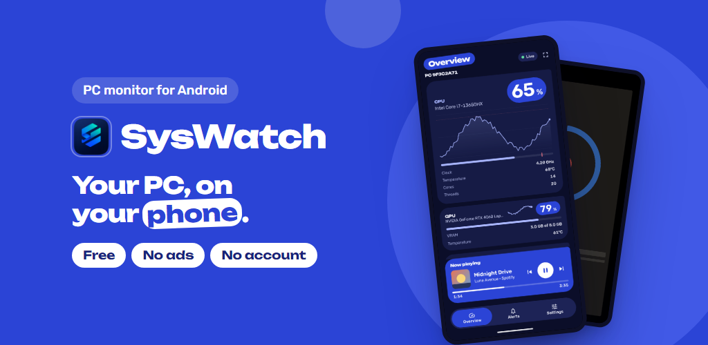
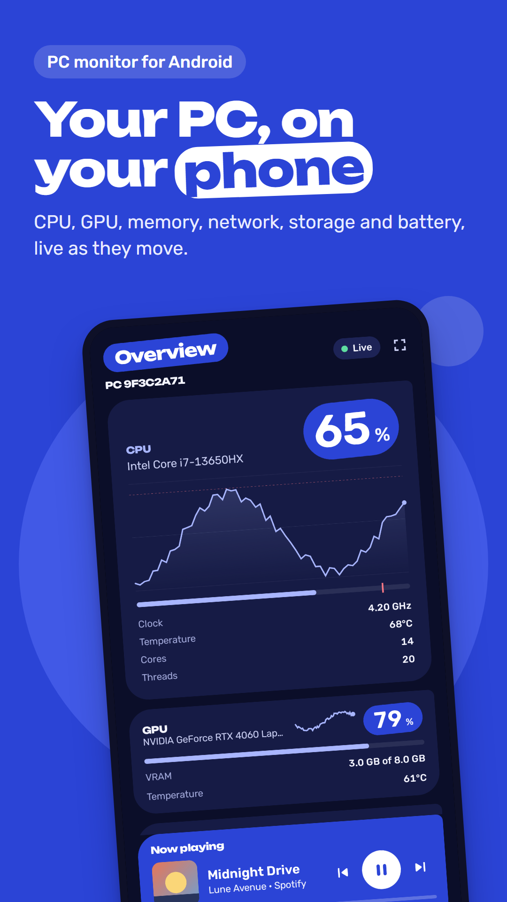
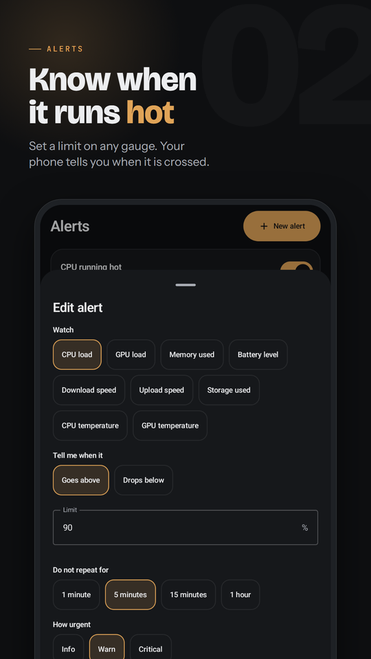
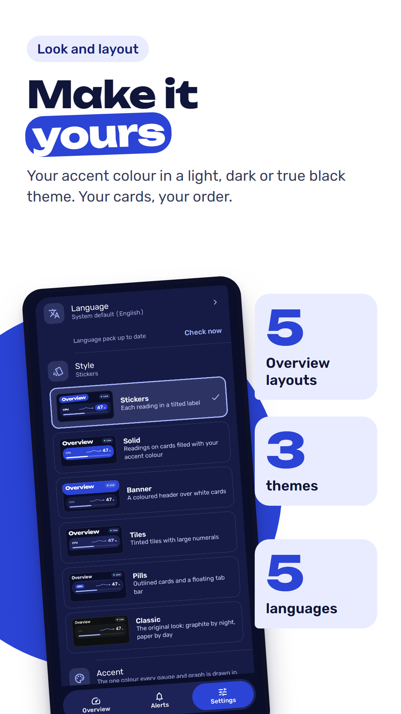
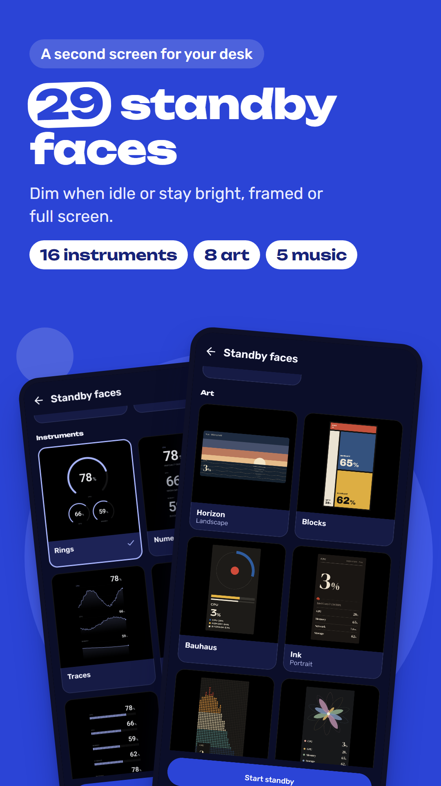
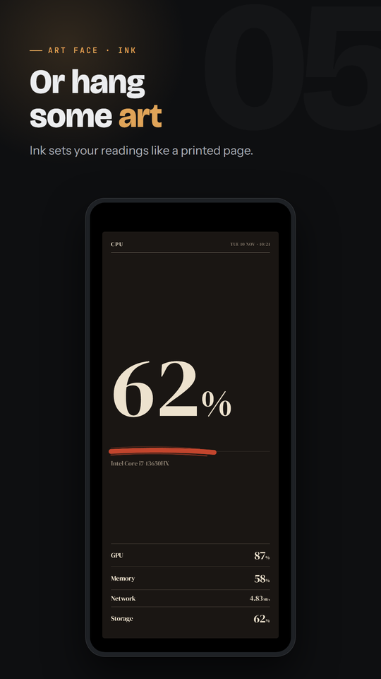
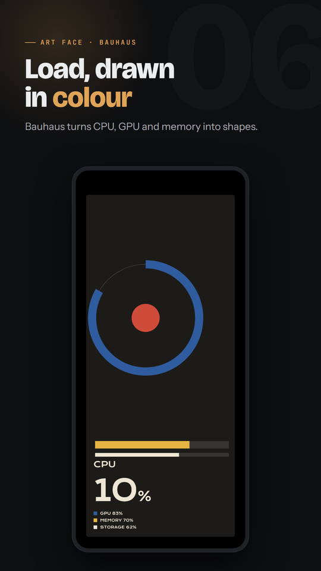
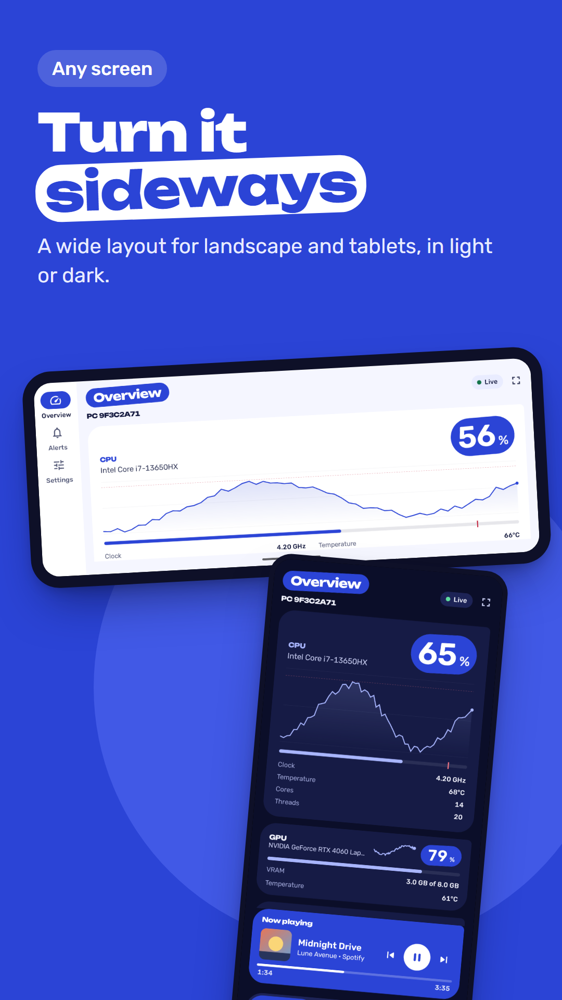
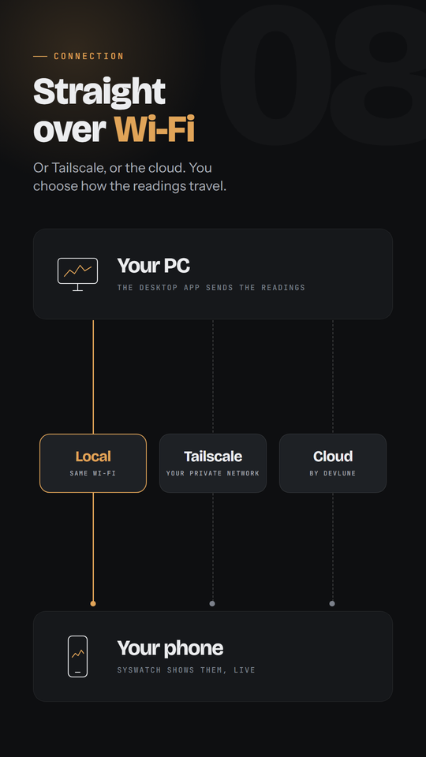
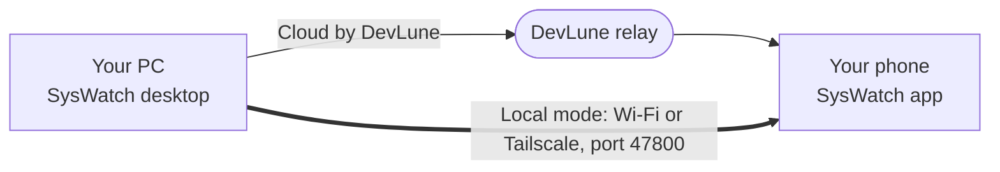

  

<h1 align="center">SysWatch</h1>

  <b>Your PC's gauges, on your phone.</b> 
  A small desktop app reads your CPU, GPU, memory, network, storage and battery. 
  Your phone shows them live, and tells you when one crosses a limit you set.

  
  

  
  
  
  
  

 

<table>
  <tr>
    <td align="center" width="25%"> <b>Live readings</b></td>
    <td align="center" width="25%"> <b>Alerts</b></td>
    <td align="center" width="25%"> <b>Your look</b></td>
    <td align="center" width="25%"> <b>24 standby faces</b></td>
  </tr>
  <tr>
    <td align="center" width="25%"> <b>Art faces</b></td>
    <td align="center" width="25%"> <b>Readings as art</b></td>
    <td align="center" width="25%"> <b>Landscape and tablet</b></td>
    <td align="center" width="25%"> <b>Three ways to connect</b></td>
  </tr>
</table>

---

## Get started in three steps

<table>
  <tr>
    <td width="33%" valign="top">
      <h3>1 &nbsp; Install on your PC</h3>
      Open the <a href="https://devlune.in/download/syswatch">download page</a>, get the Windows installer and run it. SysWatch sits in the system tray.
    </td>
    <td width="33%" valign="top">
      <h3>2 &nbsp; Install on your phone</h3>
      Get <a href="https://play.google.com/store/apps/details?id=in.devlune.syswatch">SysWatch on Google Play</a> and open it.
    </td>
    <td width="33%" valign="top">
      <h3>3 &nbsp; Scan the code</h3>
      Open <b>Pairing</b> on the PC and scan the QR code with the phone. No account, nothing to type.
    </td>
  </tr>
</table>

> [!TIP]
> Never installed software from outside a store before? The **[download and setup guide](https://devlune.in/download/syswatch)** walks through every screen, including the Windows warning you will see and what to click.

## Download

| Your PC | Status | Where |
|---|---|---|
| **Windows 10 / 11** (64-bit) | Available | [Download page](https://devlune.in/download/syswatch) · [GitHub release](https://github.com/Dev-Lune/SysWatch/releases/latest) |
| **Linux** | Not available yet | Planned. No Linux build has been made or tested. |
| **macOS** | Not available yet | Planned, same as Linux. |
| **Android phone** | Available | [Google Play](https://play.google.com/store/apps/details?id=in.devlune.syswatch) |

> [!NOTE]
> The Windows installer is not code signed yet, so Windows SmartScreen shows "Windows protected your PC". Choose **More info**, then **Run anyway**.

## Three ways to connect

Both apps ask the same question the first time they open. Pick the same answer on each; the QR code on the PC carries it anyway. You can change it later in Settings.

| | Local | Cloud by DevLune | Tailscale |
|---|---|---|---|
| **Works from** | The same Wi-Fi | Anywhere with internet | Anywhere |
| **Set up** | Nothing | Nothing | About five minutes, once |
| **Speed** | Instant, straight from the PC | About 2 seconds per update | Instant, straight from the PC |
| **Where the readings go** | Never leave your network | Through DevLune's relay | Through your own private Tailscale link |

Not sure? Pick **Local** if the phone usually sits near the PC.

<b>Setting up Tailscale</b>

 

Tailscale gives your PC and phone a private, encrypted link that works from anywhere, as if they shared one Wi-Fi. It is a separate product with a free personal plan.

1. Install Tailscale on your PC from [tailscale.com/download](https://tailscale.com/download) and sign in.
2. Install Tailscale on your phone and sign in with the **same account**.
3. In SysWatch on the PC, set the connection to **Local** and open **Pairing**. An address labelled **Tailscale** appears.
4. Scan the QR code with the phone.

At home the phone uses your Wi-Fi address. Away from home, with Tailscale on, it switches by itself.

## What it does

<table>
  <tr>
    <td width="50%" valign="top">
      <h3>See everything at a glance</h3>
      <ul>
        <li>CPU, GPU, memory, network, storage, battery and uptime</li>
        <li>History graph on every reading</li>
        <li>Five Overview layouts, phone and tablet</li>
        <li>Only real readings: nothing is shown that your PC does not report</li>
      </ul>
    </td>
    <td width="50%" valign="top">
      <h3>Alerts that come to you</h3>
      <ul>
        <li>"CPU load above 90%", "Battery level below 20%"</li>
        <li>Each limit is drawn as a red line on its gauge</li>
        <li>Quiet period per alert, so one spike is one notification</li>
        <li>Export and import your rules</li>
      </ul>
    </td>
  </tr>
  <tr>
    <td width="50%" valign="top">
      <h3>Make it yours</h3>
      <ul>
        <li>Pick your accent colour</li>
        <li>Light, dark or true black</li>
        <li>Choose which cards show and in what order</li>
        <li>Roomy or compact layout</li>
      </ul>
    </td>
    <td width="50%" valign="top">
      <h3>A second screen on your desk</h3>
      <ul>
        <li>24 standby faces, instruments and art, portrait and landscape</li>
        <li>Burn-in protection and auto dim</li>
        <li>Home screen widget in four looks</li>
      </ul>
    </td>
  </tr>
  <tr>
    <td width="50%" valign="top">
      <h3>Light on your PC</h3>
      <ul>
        <li>Lives in the tray, starts with Windows if you want</li>
        <li>Pause and resume from the tray</li>
        <li>NVIDIA GPUs read through NVML; other GPUs show what the system exposes</li>
      </ul>
    </td>
    <td width="50%" valign="top">
      <h3>Stays up to date</h3>
      <ul>
        <li>The phone app updates through Google Play and tells you what changed</li>
        <li>Five languages built in; new ones arrive without an app update</li>
        <li>The desktop app tells you when a new version is out</li>
      </ul>
    </td>
  </tr>
</table>

## Privacy, plainly

- **No account.** A 6-character pairing code is the only thing linking phone and PC.
- **Read only.** The phone can see readings. It cannot control, change or run anything on your PC.
- **Local mode** keeps readings on your own network. It is not encrypted there, so use it on networks you trust, or over Tailscale, which encrypts everything.
- **Cloud by DevLune** relays readings through DevLune's relay so the phone can reach the PC from anywhere. You never enter any server details.
- Running program names are not sent unless you switch that on.

Full policy: [devlune.in/privacy](https://devlune.in/privacy) · [Terms](https://devlune.in/terms)

## If it does not connect

| What you see | What to check |
|---|---|
| "PC not reachable" in local mode | Phone and PC on the same Wi-Fi (guest Wi-Fi isolates devices). Windows Firewall allowed SysWatch. Desktop app running. |
| Connects at home, not outside | Local mode needs Tailscale away from home. |
| "Code not found" | The PC made a new code. Open Pairing on the PC and scan again. |
| Stuck on "Paused" | The desktop app is paused. Open it and press Resume. |

Still stuck? [Open an issue](https://github.com/Dev-Lune/SysWatch/issues) or ask on [Discord](https://discord.gg/BXu9qxgaE8).

## Languages

SysWatch for Android speaks **English, Deutsch, Français, Español and Русский**. You pick the language on the first screen, and can change it any time in Settings.

**Add your language, or fix a wording.** Each language is one text file in the [`translations`](./translations) folder. No programming needed:

1. Fork this repository.
2. Copy `translations/en.xml` to a file named after your language code, for example `hi.xml`.
3. Translate the text between the tags.
4. Open a pull request. A check runs by itself and tells you in plain words if anything needs fixing.

When a translation is merged, **every SysWatch app picks it up by itself**, usually within a day. No app update is needed: the app downloads the new text, checks it on the phone, and saves it. A language that is not built in yet simply appears in the app's language list.

The full guide, with the five rules that matter, is in [`translations/README.md`](./translations/README.md).

| Language | File | Status |
|---|---|---|
| English | [`en.xml`](./translations/en.xml) | Source |
| Deutsch | [`de.xml`](./translations/de.xml) | Complete |
| Français | [`fr.xml`](./translations/fr.xml) | Complete |
| Español | [`es.xml`](./translations/es.xml) | Complete |
| Русский | [`ru.xml`](./translations/ru.xml) | Complete |

These four were translated by us and have not yet been reviewed by native speakers. If something reads wrong in your language, a correction is very welcome.

## About this repository

This repository is SysWatch's public home: releases, the changelog and these docs. Installers are attached to each [release](https://github.com/Dev-Lune/SysWatch/releases).

- [Changelog](./CHANGELOG.md)
- [Release notes](./RELEASE_NOTES.md)
- [Feature list](./FEATURES.md)
- [Install guide](./docs/INSTALL.md) · [Tailscale guide](./docs/TAILSCALE.md)
- [Translate SysWatch](./translations/README.md)

## Support SysWatch

SysWatch is free and has no ads. If it earns a place on your desk:

  
  

  Made by <a href="https://devlune.in">DevLune</a>, Hyderabad. Crafted in the dark. Shipped to the world.

